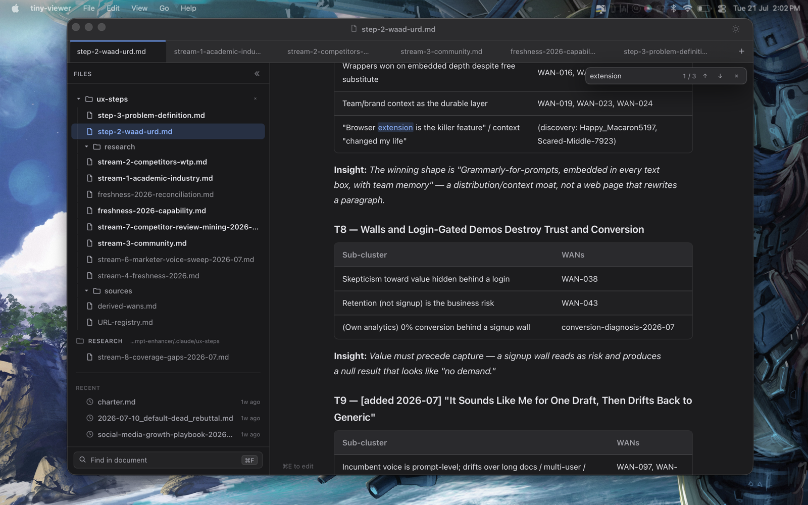

# Galley

A native macOS markdown viewer for people who read a lot of what their agents write.

Galley is a reader first. It opens a `.md` file and shows you the document — no split
pane, no preview toggle, no editor chrome you have to dismiss. It watches files on
disk and re-renders them as they change without stealing your scroll position, so you
can watch a plan get written. It keeps a scroll position per tab. It never writes to
disk unless you ask it to.




## Install

Galley runs on Macs with Apple silicon (M1 or later) and macOS 13 or later.

1. Download `Galley_0.2.0_aarch64.dmg` from the
   [latest release](https://github.com/clementiano9/galley-mac/releases/latest).
2. Open the `.dmg` and drag Galley to Applications.
3. Open Galley. macOS blocks the first launch because Galley is not notarized by Apple.
   Click **Done**, open **System Settings > Privacy & Security**, find the message about
   Galley under **Security**, and click **Open Anyway**. You do this once.

What changed in each version is in [CHANGELOG.md](CHANGELOG.md).

## How to Build Galley

### Before you start

| You need | Check it | If missing |
|---|---|---|
| macOS on Apple silicon (M1 or later) | `uname -m` prints `arm64` | Intel Macs need a universal build — [open an issue](https://github.com/clementiano9/galley-mac/issues) |
| Xcode Command Line Tools | `xcode-select -p` prints a path | `xcode-select --install` |
| Rust | `rustc --version` | `curl --proto '=https' --tlsv1.2 -sSf https://sh.rustup.rs \| sh`, then restart the terminal |
| Bun | `bun --version` | `curl -fsSL https://bun.sh/install \| bash` |

Rust installs to `~/.cargo/bin`. If `cargo` is not found afterwards, add it for the
session with `export PATH="$HOME/.cargo/bin:$PATH"`.

### Build

```bash
git clone https://github.com/clementiano9/galley-mac.git galley
cd galley/tauri-app
bun install          # a couple of seconds, one dependency
bun run tauri build  # a few minutes the first time, under a minute after that
```

The build prints two paths. The one you want:

```
tauri-app/src-tauri/target/release/bundle/macos/Galley.app
```

Drag it into `/Applications`, or double-click it where it is. There is no security
prompt, because you compiled it.

The build also writes `bundle/dmg/Galley_<version>_aarch64.dmg`, the file a release
publishes.

### Update later

```bash
cd galley && git pull
cd tauri-app && bun run tauri build
```

Quit Galley before rebuilding, then replace your copy in `/Applications`.

### Reporting something

Open an issue at
[clementiano9/galley-mac](https://github.com/clementiano9/galley-mac/issues). Useful:
what you did, what happened, what you expected, your macOS version
(`sw_vers -productVersion`), and a screenshot.

## Develop

```bash
# Native dev window — the primary loop
cd tauri-app && bun run tauri dev

# The same UI in a browser, no Rust needed. Must be HTTP, not file://
cd app && python3 -m http.server 8777   # → http://localhost:8777/index.html

# Type-check the Rust side only
cd tauri-app/src-tauri && cargo build
```

The frontend detects its host at runtime, so both work: under Tauri it routes file
open/save/watch through Rust, and in a plain browser it falls back to the File System
Access API and downloads.

### Tests

No test framework and no runtime dependencies. Tests are self-contained plain-Node
scripts that print PASS/FAIL and exit non-zero on failure:

```bash
node app/js/tv-edit.test.js                # edit-mode invariants
node app/js/tv-search.test.js              # ⌘F find-bar layout guards
node app/js/tv-round5.test.js              # cross-cutting regression suite
node app/js/tv-live.runtime.test.js        # live-watch — loads & EXECUTES tv-live.js
node app/js/tv-markdown.diagrams.test.js   # diagram render-cache (LRU) behavior

for t in app/js/*.test.js; do node "$t" >/dev/null && echo "PASS $t" || echo "FAIL $t"; done
```

## Layout

Two code trees, and they are not duplicates — one is the UI, the other is the shell
that hosts it.

| Path | What it is |
|---|---|
| [`app/`](app/) | The entire UI. Vanilla files loaded directly by `index.html`; no bundler, no transpile. Source of truth |
| [`tauri-app/`](tauri-app/) | The native macOS shell, and no UI code at all. Rust commands, the FSEvents watcher, the menu bar, bundle config |

`tauri.conf.json` sets `frontendDist: "../../app"`, so the Rust binary serves `app/`
verbatim. There is no copy step: editing `app/` changes the running native app on
reload. The flip side is that **every file under `app/` is embedded into the shipped
binary**.

The binding interface contracts are [`app/CONTRACT.md`](app/CONTRACT.md) for the
frontend module boundaries and
[`tauri-app/NATIVE-CONTRACT.md`](tauri-app/NATIVE-CONTRACT.md) for the JS ⇄ Rust
bridge. Read the relevant one before editing either side.

## License

MIT, see [LICENSE](LICENSE). Bundled libraries keep their own licenses, listed in
[THIRD-PARTY-NOTICES.md](THIRD-PARTY-NOTICES.md).
