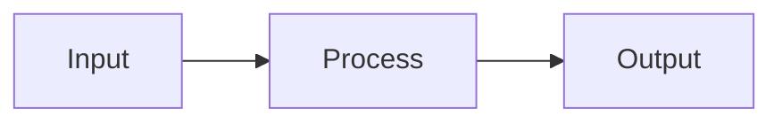

# Broken Diagram Test (UX-18)

This document contains an intentionally invalid Mermaid diagram. The viewer should
fall back to a `.dg-error` state ("Diagram failed to render") showing the raw code,
rather than spinning on the loading shimmer forever.

```mermaid
graph TD
    A[Start --> B{Is it
    C -->>> D((broken arrows и synta&x))
    subgraph
    end -- dangling
```

Some normal text after the broken diagram to confirm the rest of the document still renders.

## A valid diagram below (should still render fine)


