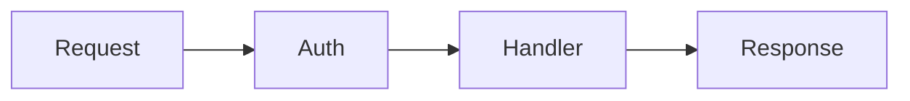

# Kitchen Sink

A sample document to test every renderer feature. Open it with `⌘O` or drag it
onto the window.

## Text

Regular paragraph with **bold**, *italic*, `inline code`, and a [link](https://example.com).

> A blockquote. Files live on disk — Galley is a lens, not a database.

## Task list

- [x] Render headings
- [x] Render tables
- [ ] Conquer the world
- [ ] Refactor later

## Table

| Service  | RAM    | Language |
|----------|--------|----------|
| Gateway  | 28MB   | Rust     |
| Core     | 42MB   | Rust     |
| Workers  | 18MB   | Go       |

## Code

```js
function greet(name) {
  // a friendly hello
  return `Hello, ${name}!`;
}
```

## Diagram



## Image


## Closing

Press `⌘K` to jump to any heading above, or double-click this paragraph to edit it.
